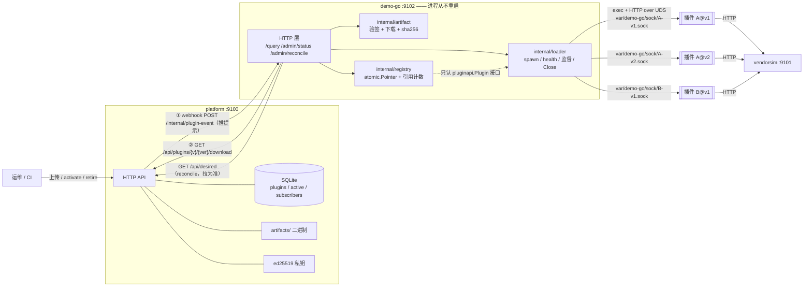
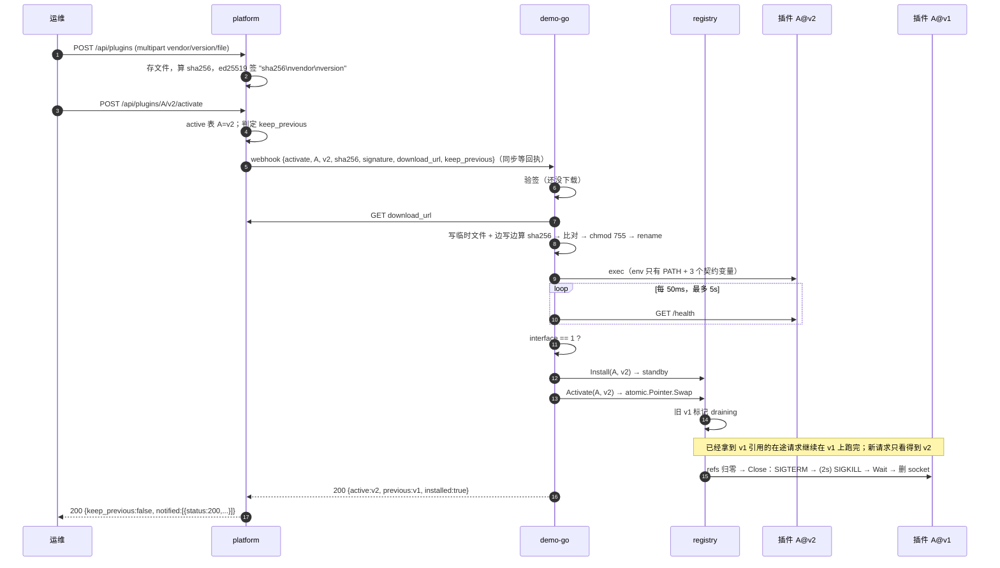
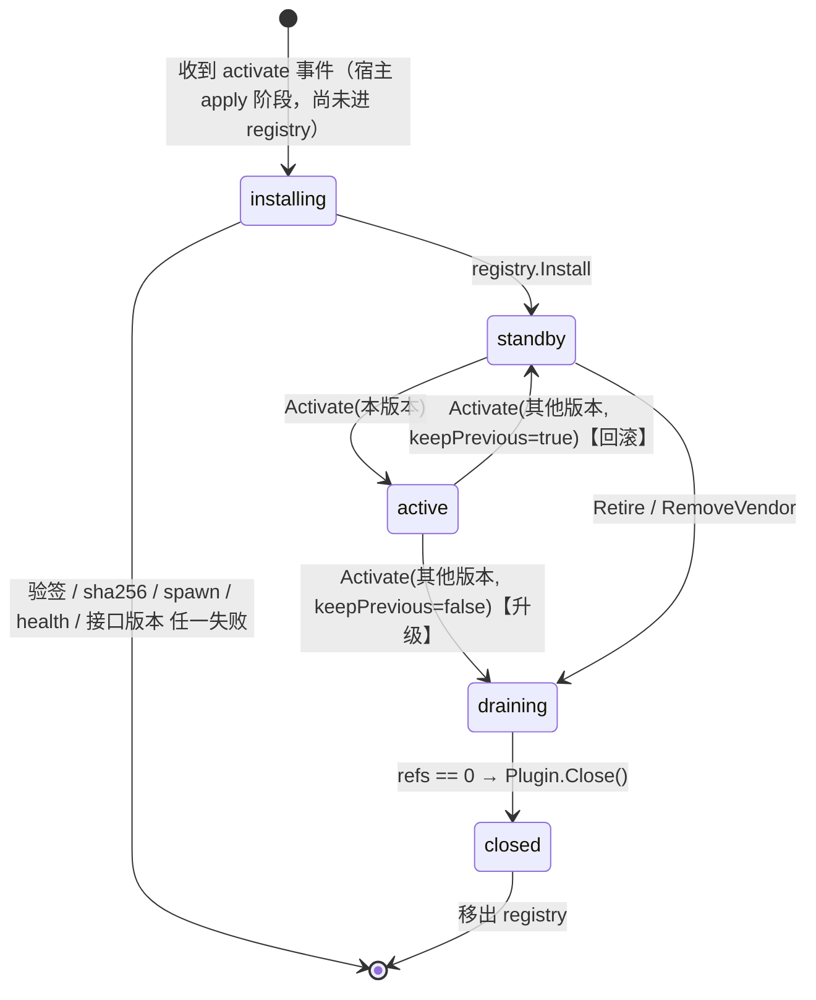

# go-hot-plugin

Go 服务进程不重启，热加载、热升级、回滚厂商插件的最小完整实现：插件是独立编译的子进程，宿主通过 unix socket 上的 HTTP 调它，管理平台用 ed25519 签名分发。

> **go-hot-plugin** is a minimal, end-to-end reference for hot-pluggable vendor plugins in a long-running Go service.
> Plugins are independently compiled binaries run as child processes and spoken to over HTTP on a unix socket; a management platform signs (ed25519) and distributes them via webhook + reconcile.
> Upgrades are zero-downtime (atomic swap + reference-counted draining), rollbacks keep the newer version on standby, and a crashing plugin never takes the host down. Pure stdlib plus one pure-Go SQLite driver.

---

## 1. 它解决什么问题

场景：K8s pod 里跑着一个 Go 服务，它要对接很多「厂商」的数据查询接口。每家厂商的 API 形状不同、变化节奏不同，于是把「调厂商 API 并映射成统一结构」做成插件。要求：

- 接入新厂商、厂商发新版本时，**服务进程不重启**（不滚动 pod、不断连接）；
- 同一厂商 v1 → v2 **热升级时在途请求不受影响**，出问题能**秒级回滚**；
- 插件崩溃、插件被篡改，**都不能连坐宿主**。

三个角色：

| 角色 | 本仓库里 | 职责 |
|---|---|---|
| 管理平台 | `cmd/platform`（:9100） | 存插件二进制、算 sha256、ed25519 签名、记录每个厂商的期望版本、发布时推 webhook、提供 `/api/desired` 供拉取 |
| 宿主 | `cmd/demo-go`（:9102） | 对外提供 `/query`；收到通知后下载、验签、拉起插件子进程、原子切换活跃版本、排空旧版本 |
| 插件 | `plugins/vendor-*` | 独立编译的可执行文件，监听宿主指定的 unix socket，实现 `GET /health` + `POST /query` |
| （假厂商） | `cmd/vendorsim`（:9101） | 模拟厂商 A v1 / A v2（换了 JSON 形状）/ B 的 HTTP API，支持 `?delay_ms=` 模拟慢请求 |

## 2. 架构



宿主内部三层各管一件事，依赖单向：`cmd/demo-go → registry / loader / artifact → pkg/pluginapi`。**registry 不 import loader**：它只认 `pluginapi.Plugin` 接口，所以把子进程换成别的加载方式（WASM、远程服务）时 registry 一行不用改。

## 3. 核心概念

### 3.1 插件是一个独立编译的子进程

不是 `.so`，不在宿主进程地址空间里。厂商用任意 Go 版本、任意依赖编译出一个可执行文件，平台分发，宿主 `exec` 它。卸载就是杀进程，内存真正归还；v1 和 v2 是两个进程，天然并存。

### 3.2 「接口 1」= unix socket 上的两个 HTTP 端点

契约全部定义在 `pkg/pluginapi/api.go`，版本号 `InterfaceVersion = 1`。

**环境变量**（宿主启动插件时只给这几个，外加 `PATH`）：

| 变量 | 含义 |
|---|---|
| `PLUGIN_SOCKET` | 插件必须监听的 unix socket 路径 |
| `PLUGIN_INTERFACE` | 宿主期望的接口版本，当前 `1` |
| `VENDOR_BASE_URL` | 厂商 API 根地址 |

**`GET /health`** → 200

```json
{"interface":1,"vendor":"A","version":"v1","pid":123}
```

**`POST /query`**，请求：

```json
{"id":"1","delay_ms":0}
```

成功 → 200，统一结构（所有厂商相同）：

```json
{"vendor":"A","id":"1","name":"A 商品 #1","price_cents":60844,"plugin_version":"v1"}
```

**错误约定**：

| 情况 | 插件返回 | 宿主 `/query` 对外返回 |
|---|---|---|
| 请求体不合法 / 缺 id | 400 `{"error":"bad_request"}` | 502 `plugin_error` |
| 调厂商失败、映射失败 | 502 `{"error":"<原因>"}` | 502 `plugin_error` + `detail` |
| 插件进程不在 / 重启中 / 连不上 socket | — | 503 `plugin_unavailable` |
| 该厂商没有活跃版本 | — | 404 `plugin_not_installed` |

契约的 Go 定义（`pkg/pluginapi/api.go`，原文）：

```go
// InterfaceVersion 是当前契约版本。插件 /health 自报的 interface 必须与之相等，否则宿主拒绝加载。
const InterfaceVersion = 1

// 插件启动时读取的环境变量。
const (
	EnvSocket        = "PLUGIN_SOCKET"    // 插件监听的 unix socket 路径
	EnvInterface     = "PLUGIN_INTERFACE" // 宿主期望的接口版本
	EnvVendorBaseURL = "VENDOR_BASE_URL"  // 厂商 API 根地址
)

// 插件必须提供的 HTTP 路径。
const (
	PathHealth = "/health" // GET  → HealthInfo
	PathQuery  = "/query"  // POST QueryRequest → QueryResponse（失败返回非 2xx + ErrorBody）
)

// QueryRequest 是 POST /query 的入参。
type QueryRequest struct {
	ID      string `json:"id"`
	DelayMS int    `json:"delay_ms"` // 透传给厂商 API，用于模拟慢请求
}

// QueryResponse 是所有厂商统一的出参结构。
type QueryResponse struct {
	Vendor        string `json:"vendor"`
	ID            string `json:"id"`
	Name          string `json:"name"`
	PriceCents    int64  `json:"price_cents"`
	PluginVersion string `json:"plugin_version"`
}

// HealthInfo 是 GET /health 的出参。
type HealthInfo struct {
	Interface int    `json:"interface"`
	Vendor    string `json:"vendor"`
	Version   string `json:"version"`
	PID       int    `json:"pid"`
}

// ErrorBody 是插件非 2xx 响应的载荷。
type ErrorBody struct {
	Error string `json:"error"`
}

// Plugin 是宿主侧看到的插件抽象。registry 只认这个接口，不关心插件如何加载。
type Plugin interface {
	Query(ctx context.Context, req QueryRequest) (QueryResponse, error)
	Health(ctx context.Context) (HealthInfo, error)
	Close() error
}

// ErrUnavailable 表示插件进程当前不可用（崩溃、重启中、已关闭）。宿主映射为 503。
var ErrUnavailable = errors.New("plugin_unavailable")
```

### 3.3 插件有多薄

插件作者只写「调厂商 + 映射」，监听 socket、`/health`、信号处理、父进程检查全由 `pluginapi.Serve` 包掉。下面是 `plugins/vendor-a-v2/main.go` 全文（厂商把接口从 `{"title","amount":"12.34"}` 改成了 `{"name","price_cents","currency"}`）：

```go
// 厂商 A 插件 v2：厂商改了接口形状 {"name","price_cents","currency"}，映射回同一个统一结构。
package main

import (
	"context"
	"net/url"

	"github.com/cfrs2005/go-hot-plugin/pkg/pluginapi"
)

func main() {
	pluginapi.Serve("A", "v2", func(ctx context.Context, base string, req pluginapi.QueryRequest) (pluginapi.QueryResponse, error) {
		var v struct {
			Name       string `json:"name"`
			PriceCents int64  `json:"price_cents"`
			Currency   string `json:"currency"`
		}
		if err := pluginapi.GetJSON(ctx, base+"/vendorA/v2/items/"+url.PathEscape(req.ID)+pluginapi.DelayQuery(req.DelayMS), &v); err != nil {
			return pluginapi.QueryResponse{}, err
		}
		return pluginapi.QueryResponse{ID: req.ID, Name: v.Name, PriceCents: v.PriceCents}, nil
	})
}
```

`plugin_version` 与 `vendor` 由 `Serve` 用插件自报的值填写，所以「请求到底由哪个版本处理」在响应里一眼可见——后面热升级的验收就靠它。

## 4. 发布一次插件的完整时序



逐步对照源码：

1. **上传**：`cmd/platform/main.go` `upload()`。校验 vendor/version 只含 `[A-Za-z0-9._-]`（防路径穿越），存到 `artifacts/<vendor>/<version>/plugin`，用 `io.MultiWriter` 边写边算 sha256，同 vendor@version 重复上传 409。
2. **签名**：`internal/artifact/artifact.go` `Sign()` / `SignedMessage()`。被签的是 `sha256_hex + "\n" + vendor + "\n" + version`——把 vendor 和 version 一起签进去，B 的合法产物不能冒充 A，v1 的产物也不能冒充 v2：

```go
// SignedMessage 是被签名的字节：sha256 + "\n" + vendor + "\n" + version。
func SignedMessage(sha, vendor, version string) []byte {
	return []byte(sha + "\n" + vendor + "\n" + version)
}

// Sign 返回 base64 签名。
func Sign(priv ed25519.PrivateKey, sha, vendor, version string) string {
	return base64.StdEncoding.EncodeToString(ed25519.Sign(priv, SignedMessage(sha, vendor, version)))
}

// VerifySignature 校验平台对 (sha, vendor, version) 的签名。
func VerifySignature(pub ed25519.PublicKey, sha, vendor, version, sigB64 string) error {
	sig, err := base64.StdEncoding.DecodeString(sigB64)
	if err != nil || len(sig) != ed25519.SignatureSize || !ed25519.Verify(pub, SignedMessage(sha, vendor, version), sig) {
		return ErrBadSignature
	}
	return nil
}
```

3. **activate**：`cmd/platform/main.go` `activate()`。更新 `active` 表，并决定 `keep_previous`（见 §5.3）：

```go
func (s *server) activate(w http.ResponseWriter, r *http.Request) {
	vendor, version := r.PathValue("vendor"), r.PathValue("version")
	p, err := s.db.getPlugin(vendor, version)
	if err != nil {
		writeErr(w, 404, "not_found")
		return
	}
	ev := s.eventFor("activate", p)
	// 回滚判定：目标版本比当前活跃版本更早上传 → 让宿主保留当前版本为 standby。
	if cur, err := s.db.activeRow(vendor); err == nil && cur.Version != version && p.ID < cur.ID {
		ev.KeepPrevious = true
	}
	if err := s.db.setActive(vendor, version); err != nil {
		writeErr(w, 500, err.Error())
		return
	}
	logger.Printf("activate %s@%s keep_previous=%v notify=%v", vendor, version, ev.KeepPrevious, notify(r))
	writeJSON(w, 200, map[string]any{"vendor": vendor, "version": version, "keep_previous": ev.KeepPrevious, "notified": s.maybeNotify(r, ev)})
}
```

4. **webhook**：`maybeNotify()` 并行 POST 给所有订阅者，**同步等回执**，把每个订阅者的状态码和回执原样放进 activate 的响应里；失败只记日志、不重试（由 reconcile 兜底，见 §7）。
5. **宿主收事件**：`cmd/demo-go/main.go` `event()` → `cmd/demo-go/apply.go` `applyActivate()`。顺序是 **先验签、再下载**：签名对不上直接 403，连下载都不发生。
6. **下载 + 校验**：`internal/artifact/artifact.go` `Fetch()`。写同目录临时文件，sha256 不一致就删掉临时文件返回 `ErrShaMismatch`——被篡改的文件**永远不会出现在最终路径上**；一致才 `chmod 755` + `rename`（同目录 rename 是原子的）：

```go
	tmp, err := os.CreateTemp(filepath.Dir(dest), ".download-*")
	if err != nil {
		return err
	}
	defer os.Remove(tmp.Name()) // rename 成功后这是 no-op
	h := sha256.New()
	if _, err := io.Copy(io.MultiWriter(tmp, h), resp.Body); err != nil {
		tmp.Close()
		return fmt.Errorf("download: %w", err)
	}
	if err := tmp.Close(); err != nil {
		return err
	}
	if got := hex.EncodeToString(h.Sum(nil)); got != wantSha {
		return fmt.Errorf("%w: want %s got %s", ErrShaMismatch, short(wantSha), short(got))
	}
	if err := os.Chmod(tmp.Name(), 0o755); err != nil {
		return err
	}
	return os.Rename(tmp.Name(), dest)
}
```

7. **spawn + health**：`internal/loader/loader.go` `Start()` → `spawn()`，见 §6。
8. **Install + Activate**：`registry.Install()` 登记为 standby，`registry.Activate()` 原子切换，见 §5。整个 apply 过程由 `applyMu` 串行化，任一步失败都直接返回错误，**当前活跃版本不变**。
9. **排空与关闭**：旧版本 `draining`，最后一个在途请求 `release()` 时触发 `Close()`，见 §5.2 与 §6.4。

## 5. registry：状态机与并发模型

### 5.1 状态机



`installing` 是宿主 `applyActivate()` 里「下载 → 校验 → spawn → health」那段，registry 看不到它；registry 内部只有 `standby / active / draining` 三个状态（`internal/registry/registry.go` 的 `State` 常量），`closed` 即已移出注册表。每个状态迁移的完整触发条件见 [`docs/design.md`](docs/design.md#状态转换条件表)。

### 5.2 atomic.Pointer 切换 + 引用计数排空

数据结构：每个 vendor 一个 `slot`，`active` 是 `atomic.Pointer[Entry]`，`versions` 存所有已装版本；每个 `Entry` 带 `refs atomic.Int64` 与 `draining atomic.Bool`。

**调用路径**（`cmd/demo-go/main.go` `query()`）：取活跃版本时 refs+1，用完 refs-1：

```go
	e, release, err := h.reg.Acquire(vendor)
	if err != nil {
		writeJSON(w, 404, map[string]string{"error": "plugin_not_installed"})
		return
	}
	defer release()
	resp, err := e.Plugin.Query(r.Context(), pluginapi.QueryRequest{ID: id, DelayMS: delay})
```

`Acquire`（`internal/registry/registry.go`）：先加引用，再检查是否已在排空；若恰好撞上切换就退回并重读活跃指针：

```go
func (r *Registry) Acquire(vendor string) (*Entry, func(), error) {
	r.mu.RLock()
	s := r.vendors[vendor]
	r.mu.RUnlock()
	if s == nil {
		return nil, nil, ErrNotInstalled
	}
	for {
		e := s.active.Load()
		if e == nil {
			return nil, nil, ErrNotInstalled
		}
		e.refs.Add(1)
		if !e.draining.Load() {
			var once sync.Once
			return e, func() { once.Do(e.release) }, nil
		}
		e.release()
	}
}
```

`Activate`：在写锁内 `Swap` 活跃指针，旧版本按 `keepPrevious` 决定排空还是转 standby：

```go
func (r *Registry) Activate(vendor, version string, keepPrevious bool) (prev string, err error) {
	r.mu.Lock()
	defer r.mu.Unlock()
	s := r.vendors[vendor]
	if s == nil || s.versions[version] == nil || s.versions[version].draining.Load() {
		return "", ErrNotInstalled
	}
	e := s.versions[version]
	old := s.active.Swap(e)
	if old == nil || old == e {
		return "", nil
	}
	if !keepPrevious {
		r.drain(old)
	}
	return old.Version, nil
}
```

`drain` / `release` / `tryClose`：标记排空；引用归零的那一刻（无论是 drain 时已经是 0，还是最后一个请求 release 时）`closeOnce` 异步关闭插件，不阻塞正在返回的请求：

```go
func (r *Registry) drain(e *Entry) {
	if e.draining.CompareAndSwap(false, true) {
		r.logf("%s@%s 进入 draining（在途 %d）", e.Vendor, e.Version, e.refs.Load())
	}
	e.tryClose()
}

func (e *Entry) release() {
	if e.refs.Add(-1) == 0 {
		e.tryClose()
	}
}

func (e *Entry) tryClose() {
	if !e.draining.Load() || e.refs.Load() != 0 {
		return
	}
	e.closeOnce.Do(func() {
		go func() { // Close 可能要等子进程退出，不阻塞释放引用的请求
			if err := e.Plugin.Close(); err != nil {
				e.reg.logf("关闭 %s@%s 出错: %v", e.Vendor, e.Version, err)
			}
			e.reg.forget(e)
			e.reg.logf("%s@%s 已排空并关闭", e.Vendor, e.Version)
			close(e.closed)
		}()
	})
}
```

**为什么不会把请求发到已关闭的插件上**：关闭的条件是 `draining && refs == 0`；`Acquire` 的顺序是「先 refs+1，再读 draining」。若读到 `draining=false`，说明加引用发生在标记排空之前，此后 refs 至少为 1，关闭不会发生，直到这个请求 release；若读到 `draining=true`，它立刻 release 并重读已经换好的新指针。两种交错都安全。`sync/atomic` 的操作在 Go 内存模型里是顺序一致的，这个论证成立。

**怎么验证的**：`internal/registry/registry_test.go` 的 `TestConcurrentSwapNeverHitsClosed` 起 8 个协程不停 `Acquire → Query → release`，主协程同时做 200 次 `Install + Activate`，断言没有任何一次 Query 落到已关闭的插件上；`make verify` 用 `go test -race` 跑它。另外两个单测覆盖「在途请求未结束时旧版本不被关闭」和「回滚保留 standby、活跃版本不能 Retire」。

### 5.3 升级排空、回滚保留：`keep_previous` 规则

- **升级**（目标版本比当前活跃版本**后**上传）：旧版本 draining，排空即关。升级是「确认要换」，留着旧进程只占资源。
- **回滚**（目标版本比当前活跃版本**先**上传）：平台在事件里置 `keep_previous=true`，宿主把被换下来的新版本留作 standby——进程不杀，随时可以再前滚回去（再 activate 它只是一次指针交换，不重新下载、不重新 spawn）。确认回滚后由运维显式 `retire` 它。
- 判定在平台做（`activate()` 里的 `p.ID < cur.ID`，按上传顺序，不解析版本号字符串），宿主只执行。reconcile 路径一律 `keep_previous=false`，收敛到最小状态。

## 6. loader：子进程生命周期

### 6.1 spawn：不泄露宿主环境

`internal/loader/loader.go` `spawn()`：启动前先删掉同名旧 socket；`cmd.Env` 显式构造，**不继承宿主的环境变量**（宿主的数据库密码、云凭证不会出现在插件进程里），只给 `PATH` 和契约变量；`VENDOR_BASE_URL` 由宿主经 `Spec.Env` 追加：

```go
func (p *Proc) spawn(ctx context.Context) error {
	_ = os.Remove(p.spec.SocketPath)
	cmd := exec.Command(p.spec.Binary)
	// 不继承宿主环境（等价 go-plugin 的 SkipHostEnv），只给 PATH 与契约变量。
	cmd.Env = append([]string{
		"PATH=" + os.Getenv("PATH"),
		pluginapi.EnvSocket + "=" + p.spec.SocketPath,
		pluginapi.EnvInterface + "=" + strconv.Itoa(pluginapi.InterfaceVersion),
	}, p.spec.Env...)
	cmd.Stdout, cmd.Stderr = os.Stderr, os.Stderr
	if err := cmd.Start(); err != nil {
		return fmt.Errorf("spawn %s: %w", p.name(), err)
	}
	p.spec.Logf("spawn %s 子进程 pid=%d，等待 /health", p.name(), cmd.Process.Pid)
	exited := make(chan struct{})
	go func() { _ = cmd.Wait(); close(exited) }()
```

插件的 stdout/stderr 接到宿主 stderr，日志里带 `[plugin A@v1 pid=…]` 前缀。

### 6.2 health 等待与接口版本校验

spawn 后每 50ms `GET /health`（单次超时 500ms），总超时 `StartTimeout`（默认 5s）。三种失败都会先 Kill 子进程再返回错误：健康检查超时、子进程在通过前自己退出、`/health` 自报的 `interface` 不等于宿主的 `InterfaceVersion`（`ErrInterfaceMismatch`，宿主回 422 `interface_mismatch`）。契约一旦不兼容就 bump 版本号，旧插件会被拒绝而不是带着错误语义上线。

### 6.3 监督与重启

每个 `Proc` 有一个监督协程等子进程退出。`Close()` 导致的退出（`closing=true`）直接结束监督；**意外退出**则标记不可用（期间 `/query` 返回 503），最多重启 `MaxRestarts=3` 次（终身累计），每次前退避 `RestartBackoff=1s`：

```go
		p.spec.Logf("%s 子进程 pid=%d 意外退出", p.name(), pid)
		for {
			if p.closing.Load() {
				return
			}
			p.mu.Lock()
			if p.restarts >= p.spec.MaxRestarts {
				p.mu.Unlock()
				p.spec.Logf("%s 已重启 %d 次，放弃；保持不可用", p.name(), p.spec.MaxRestarts)
				return
			}
			p.restarts++
			n := p.restarts
			p.mu.Unlock()
			time.Sleep(p.spec.RestartBackoff)
			if p.closing.Load() {
				return
			}
			p.spec.Logf("%s 第 %d 次重启", p.name(), n)
			if err := p.spawn(context.Background()); err != nil {
				p.spec.Logf("%s 重启失败: %v", p.name(), err)
				continue
			}
			// 重启期间被 Close 了：Close 可能拿到的是旧 cmd，这里补杀新进程。
			if p.closing.Load() {
				p.signal(syscall.SIGKILL)
			}
			break
		}
```

外层循环在 `<-exited` 处等待，`closing=true` 时直接返回（Close 导致的退出不重启）。重启期间如果恰好被 Close，`Close` 手里拿的可能是旧的 cmd，所以重启成功后再检查一次 `closing` 补杀新进程。

### 6.4 Close：SIGTERM → 2s → SIGKILL → 删 socket

```go
func (p *Proc) Close() error {
	if !p.closing.CompareAndSwap(false, true) {
		<-p.done
		return nil
	}
	p.up.Store(false)
	p.signal(syscall.SIGTERM)
	select {
	case <-p.done:
	case <-time.After(2 * time.Second):
		p.signal(syscall.SIGKILL)
		<-p.done
	}
	p.client.reset()
	_ = os.Remove(p.spec.SocketPath)
	return nil
}
```

`<-p.done` 保证返回时子进程已被 `Wait` 回收（不留僵尸进程，`kill -0 pid` 必然失败）。

### 6.5 插件侧防孤儿

宿主被 `kill -9` 时来不及关插件。`pluginapi.Serve` 每秒比较一次 `os.Getppid()`，父进程变了就自己退出（`pkg/pluginapi/serve.go`）：

```go
	sig := make(chan os.Signal, 1)
	signal.Notify(sig, syscall.SIGTERM, syscall.SIGINT)
	ppid := os.Getppid()
	tick := time.NewTicker(time.Second)
	defer tick.Stop()
loop:
	for {
		select {
		case s := <-sig:
			logger.Printf("收到 %v，退出", s)
			break loop
		case <-tick.C:
			if os.Getppid() != ppid { // 宿主没了就自己退，不留孤儿
				logger.Printf("父进程 %d 已消失，退出", ppid)
				break loop
			}
		}
	}
```

## 7. 分发与一致性：推提示，拉为准

- **推**：activate / retire 时平台同步 POST webhook。秒级生效，但会丢：宿主当时不在、网络抖动、pod 重建后 IP 变了。
- **拉**：宿主每 `RECONCILE_INTERVAL`（默认 60s）拉一次 `GET /api/desired`，也可 `POST /admin/reconcile` 手动触发。`/api/desired` 返回每个 vendor 的期望版本（带 sha256、签名、下载地址，和 webhook 载荷同构）以及平台上已退役的版本列表。
- reconcile 和 webhook 走**同一个** `applyActivate()`，校验逻辑只有一份。

reconcile 只做三类动作（`cmd/demo-go/apply.go` `reconcile()`，33 行）：

1. 活跃版本缺失或与期望不一致（版本或 sha256 不同）→ 装并切换；
2. 平台已不期望的 vendor → `RemoveVendor`，全部排空；
3. 平台标记为已退役的版本 → `Retire`。

注意它**不会误关 standby**：回滚后保留的新版本既不是「不期望的 vendor」，也没有被平台标记退役，所以 reconcile 不动它。

**同版本重复 activate**：宿主已装同一 vendor@version 时，会比对已装产物的 sha256 与事件里的 sha256，不一致返回 409 `sha256_mismatch`——同一个版本号绝不静默换成另一个二进制。一致则只做指针切换，不重新下载。

## 8. 安全模型

**签名覆盖什么**：`sha256(二进制) + vendor + version`。宿主持有平台公钥，事件里的 sha256 必须有平台签名背书，下载到的字节必须哈希到这个 sha256。

**挡住了什么**（都由 `make verify` 第 6 步实测）：

| 篡改方式 | 在哪一步被拦 | 宿主响应 |
|---|---|---|
| 事件里的 sha256 被改（签名没覆盖它） | 验签，下载前 | 403 `signature_invalid` |
| sha256 和签名都是真的，但下载地址指向别的二进制（产物被换） | `Fetch()` 下载后比对 | 422 `sha256_mismatch`，临时文件删除 |
| sha256 是真的，签名是别的版本的 | 验签，下载前 | 403 `signature_invalid` |
| 同 vendor@version 已装，事件带来另一个 sha256 | apply 时比对已装产物 | 409 `sha256_mismatch` |
| 插件实现了不兼容的契约版本 | health 检查 | 422 `interface_mismatch` |

**挡不住什么**（demo 刻意未做，见 §13）：

- **降级攻击**：`/internal/plugin-event` 没有鉴权。攻击者装不进恶意产物，但可以重放一个旧的、合法签名的 activate 事件，把厂商切回有漏洞的旧版本。
- **webhook 无鉴权**：同上，任何能访问宿主端口的人都能触发下载和切换。
- **TOFU 公钥**：宿主启动时向平台 `GET /api/pubkey` 并直接信任。启动那一刻平台被冒充，整个签名链就是攻击者的。

## 9. 快速开始

需要 Go 1.25+、bash、curl、python3（`demo.sh` 用它解析 JSON，不需要 jq）。

```bash
git clone https://github.com/cfrs2005/go-hot-plugin && cd go-hot-plugin
make build        # 产物在 bin/：platform、demo-go、vendorsim、verify、plugins/{vendor-a-v1,vendor-a-v2,vendor-b}
```

### 9.1 一键分步演示

每一步打印「做了什么 / 结果 / 判定」，并比对 demo-go 主进程 pid，证明全程没有重启。

```bash
./demo.sh up       # 构建并后台起三个服务（nohup，日志与 pid 在 var/logs/），已在跑则跳过
./demo.sh 1        # 厂商 A 从无到有：未装时 404 → 上传 v1 + 发布 → 查到 v1；附 demo-go 的 验签/下载/spawn/切换 日志
./demo.sh 2        # 厂商 B 并存：B 可查，A 仍是 v1
./demo.sh 3        # A 热升级：3 秒慢请求在 v1 上走完，新请求立刻走 v2，v1 排空后进程退出（kill -0 确认）
./demo.sh 4        # 回滚：切回 v1，v2 变 standby；retire v2 后 v2 进程退出
./demo.sh 5        # 篡改：伪造 sha256 的事件直接打宿主 → 403 signature_invalid，A 仍 v1
./demo.sh 6        # 崩溃：kill -9 插件 → 立刻 503 → 约 1 秒后自动拉起恢复 200，restarts=1
./demo.sh all      # 顺序跑 1~6，最后打印状态表
./demo.sh status   # 中文表格：主进程 pid、各厂商活跃版本、各版本子进程 pid / 状态 / refs / 重启次数
./demo.sh down     # 停三个服务和插件子进程，清空 var/
```

任一步都能单独跑：服务没起会先自动 `up`；前置状态不满足（比如直接跑 3 但 A v1 没装）会自动补齐，并在「做了什么」里写明。第 6 步每次消耗一次重启额度（终身 3 次），连跑 4 次以上需要 `down && up`。

### 9.2 三个服务各自前台跑

```bash
make run-vendorsim   # :9101
make run-platform    # :9100，数据在 var/platform/（platform.db、artifacts/、ed25519.key）
make run-demo        # :9102，工作目录 var/demo-go/（plugins/、sock/）
make run-all         # 一个终端里同时起三个，Ctrl-C 一起停
```

端口、地址都能用环境变量覆盖：`PLATFORM_ADDR` `PLATFORM_DATA_DIR` `PLATFORM_PUBLIC_URL` `VENDORSIM_ADDR` `DEMO_ADDR` `DEMO_WORK_DIR` `DEMO_CALLBACK_URL` `PLATFORM_URL` `VENDOR_BASE_URL` `RECONCILE_INTERVAL`。

### 9.3 手工 curl

```bash
P=http://127.0.0.1:9100; D=http://127.0.0.1:9102

curl -s "$D/query?vendor=A&id=1"                                  # 404 plugin_not_installed

curl -s -F vendor=A -F version=v1 -F file=@bin/plugins/vendor-a-v1 $P/api/plugins
curl -s -X POST $P/api/plugins/A/v1/activate                      # 平台推 webhook → 宿主下载/验签/spawn/切换
curl -s "$D/query?vendor=A&id=1"                                  # plugin_version=v1

curl -s "$D/query?vendor=A&id=2&delay_ms=3000" &                  # 一个 3 秒的在途请求
curl -s -F vendor=A -F version=v2 -F file=@bin/plugins/vendor-a-v2 $P/api/plugins
curl -s -X POST $P/api/plugins/A/v2/activate
curl -s "$D/query?vendor=A&id=1"                                  # plugin_version=v2；后台那个慢请求返回 v1
curl -s $D/admin/status                                           # v1: draining, refs=1 → 稍后消失

curl -s -X POST $P/api/plugins/A/v1/activate                      # 回滚，keep_previous=true，v2 standby
curl -s -X POST "$P/api/plugins/A/retire?version=v2"              # 确认后退役 v2

curl -s -X POST "$P/api/plugins/A/v2/activate?notify=false"       # 不推 webhook
curl -s -X POST $D/admin/reconcile                                # 靠拉取对齐
```

平台 API 全表见 [`docs/design.md`](docs/design.md#平台-api)。

## 10. 验收：`make verify`

`make verify` = `make build` → `go vet ./...` → `go test -race ./...` → `bin/verify`。`bin/verify` 起真进程（vendorsim、platform、demo-go，demo-go 设 `RECONCILE_INTERVAL=1h`，保证前 7 步只能靠 webhook），逐条断言，结束时 SIGTERM 全部进程、确认所有见过的插件子进程都已退出、清理 `var/verify/`。它用**独立端口 19100–19102 和独立目录 `var/verify/`**，与手工起的 9100–9102 互不干扰（`VERIFY_PORT_*` 可改端口，`VERIFY_KEEP=1` 保留日志）。

| 步骤 | 验什么 | 断言数 |
|---|---|---|
| 1 | demo-go 启动、未装插件时 `/query?vendor=A` → 404 `plugin_not_installed`；记录宿主 pid | 1 |
| 2 | 上传 A v1 + activate：webhook 回执 200；3s 内查到 `plugin_version=v1`；name / price_cents 与 vendorsim 原始数据一致 | 3 |
| 3 | 上传 B + activate：B 可查且数据一致；A 仍为 v1 | 2 |
| 4 | 热升级：先发 3s 慢请求，200ms 后 activate v2；慢请求在途时 v1 `refs≥1` 且 draining；新请求走 v2 且数据一致；慢请求最终由 v1 返回；之后 2s 内 v1 子进程退出、status 中消失 | 5 |
| 5 | 回滚：平台判定 `keep_previous=true`；查询返回 v1；v2 为 standby 且进程存活；retire v2 后进程退出 | 4 |
| 6 | 三种伪造事件全部被拒（403 / 422 / 403），每次之后 A 仍为 v1、v2 未被装上 | 3 |
| 7 | `kill -9` 活跃插件：宿主 pid 不变、status 可访问；5s 内恢复 200，新 pid、`restarts=1` | 3 |
| 8 | `notify=false` 发布 B v2：响应里无投递；reconcile 前 B 仍 v1；`POST /admin/reconcile` 后 5s 内 B 活跃版本为 v2；B 仍可查 | 4 |
| 9 | 全程宿主 pid 与第 1 步一致 | 1 |
| 收尾 | 宿主退出后，所有观察到的插件子进程都已回收 | — |

合计 26 条断言，任一 FAIL 退出码非 0。

## 11. 设计裁定：为什么是「子进程 + HTTP/UDS」

调研全文见 [`docs/research-hot-plugin-2026-11-05.md`](docs/research-hot-plugin-2026-11-05.md)，结论表：

| 路线 | 热加载 | 热卸载 | 多版本并存 / 回滚 | 厂商独立编译 | 隔离 | 单次调用开销 | 结论 |
|---|---|---|---|---|---|---|---|
| 标准库 `plugin`（.so） | 可 | **不可**（golang/go#20461，官方表示不会加） | 只能叠加，内存只增不减 | **否**：须同 toolchain、同依赖、同 build flag；须 cgo | 无，同地址空间 | ~30ns | 否决 |
| yaegi 解释器 | 可 | 无 Close，靠 GC，不可靠 | API 上可以 | 源码分发；stdlib 符号只到 Go 1.22 | 无 | 解释执行约慢 100× | 否决 |
| hashicorp/go-plugin（子进程 + gRPC） | 可 | 可，`Kill()` 真释放 | 可，一版本一进程 | 是，只约定 proto | 进程级（同 UID） | ~100–400µs | 可行 |
| wazero WASM | 可 | 可（有已知泄漏 bug） | 可 | 是，只约定 wasm ABI | 沙箱，内存可限 | 无权威数据 | 可行，但 wasip1 无 socket，插件不能自己调厂商 API，HTTP 全靠宿主代办 |
| 每厂商一个 Deployment | K8s 滚动 | pod 级 | 蓝绿 / 金丝雀现成 | 是 | 容器级最强 | ~1ms 网络跳 | 运维最稳，但不满足「pod 内」 |
| **本实现：子进程 + HTTP over UDS** | 可 | 可，杀进程 | 可，一版本一进程 | 是，只约定两个 HTTP 端点 | 进程级（同 UID） | 与 go-plugin 同量级 | **采用** |

**和 hashicorp/go-plugin 的关系**：同一个模型——宿主 exec 插件子进程、经 unix socket 通信、一个版本一个进程、Kill 即卸载。go-plugin 多了 stdout 握手协议、gRPC 代码生成、AutoMTLS、`SecureConfig` 校验二进制哈希；本实现用标准库 HTTP + JSON 代替 gRPC 握手，契约能用 `curl --unix-socket` 直接调试，零依赖，代价是没有强类型 IDL 与流式调用。本仓库真正要演示的是传输层之上的东西——**registry 的原子切换与排空、平台的签名分发、reconcile**——它们只依赖 `pluginapi.Plugin` 接口。生产上想要 gRPC 强类型或 mTLS，可以把 `internal/loader` 换成 go-plugin 的 `Client` 包一层实现同样的接口，registry、artifact、平台都不用动。

## 12. 性能数据

本机 Apple Silicon（M 系列）Mac、Go 1.25.0 实测，取自 `make verify` 多次运行的输出（全部在 127.0.0.1，包含 vendorsim 往返）：

| 指标 | 数值 | 说明 |
|---|---|---|
| 一次查询（宿主 → UDS → 插件 → vendorsim → 返回） | ~2ms | 第 2 步发布后首次查询耗时 |
| 热升级 activate 总耗时 | 643–747ms | 平台同步等回执：下载 ~8MB 二进制 + 校验 + spawn + health 通过 + 切换 |
| 旧版本排空后到进程退出 | ~51ms | 最后一个在途请求返回 → SIGTERM → 进程被回收 |
| 插件被 `kill -9` 到恢复 200 | 1.08–1.15s | 其中 1s 是重启退避；期间约 20 次请求得到 503 |
| 首次 spawn 到 health 通过 | 30ms–1.5s | 新二进制首次执行时 macOS 会做安全扫描，偏慢；Linux 无此开销 |

没有做压测；单次调用开销的量级参考调研文档里 go-plugin 的 benchmark（~100–400µs/op）。

## 13. 生产化差距

- **公钥固定**：demo 用 TOFU。生产要把平台公钥打进镜像或 Secret，并支持多公钥并存以便轮换。
- **webhook 鉴权与防降级**：给 webhook 请求体加 HMAC + 时间戳防重放；事件携带单调递增的发布序号，宿主拒绝比当前更旧的序号（显式回滚由平台签发新序号）。
- **多副本一致性**：Deployment 多副本时各自订阅、各自切换，切换时刻不一致；pod 重建后旧订阅地址变死链（投递失败只记日志）。应以 `/api/desired` 为准，订阅加 TTL / 心跳，或改为 pod 长轮询 / watch。
- **noexec 挂载**：下载目录必须可执行。K8s 上用 emptyDir；若集群对卷启用 `noexec`，需为插件目录豁免。`readOnlyRootFilesystem` 不冲突。
- **同 UID 隔离**：插件与宿主同 UID，能读宿主可读的文件。环境变量已不继承，但真正隔离还需降权 UID、seccomp、cgroup 限额、出口白名单——或干脆每厂商一个 Deployment。
- **资源与超时**：插件没有内存 / CPU 上限；插件调用没有独立超时（依赖调用方断连）；重启额度用完后一直 503，直到下一次 activate。
- **其他**：回滚判定按平台上传顺序而非语义化版本；artifact 只在平台本地盘，没有对象存储；宿主不清理旧版本二进制；unix socket 路径受 104 字节限制（macOS），工作目录太深时宿主启动即报错。

## 14. 目录结构

```
cmd/platform/       管理平台：main.go（HTTP、签名、webhook、/api/desired）、store.go（SQLite）
cmd/demo-go/        宿主：main.go（HTTP、启动、status）、apply.go（activate / retire / reconcile）
cmd/vendorsim/      假厂商 API：A v1 / A v2（换了形状）/ B，支持 ?delay_ms=
cmd/verify/         端到端验收：main.go（进程与 HTTP 工具）、steps.go（9 步断言）
plugins/vendor-a-v1/  plugins/vendor-a-v2/  plugins/vendor-b/   三个插件，各 ~25 行
pkg/pluginapi/      接口 1 契约（api.go）+ 插件侧 Serve 帮助函数（serve.go）
internal/registry/  版本注册表：atomic.Pointer 切换 + 引用计数排空（含并发单测）
internal/loader/    子进程生命周期：spawn / health / 监督重启 / Close；UDS HTTP 客户端
internal/artifact/  签名消息格式、下载与 sha256 校验、webhook 事件类型
docs/               design.md（契约附录、状态转换表、平台 API、verify 内部实现）、调研文档
demo.sh             一键分步演示
Makefile            build / test / verify / run-*
```

依赖：Go 标准库 + `modernc.org/sqlite`（纯 Go，无 cgo，仅平台使用）。`Makefile` 固定 `GOTOOLCHAIN=local`；sqlite 钉在 v1.44.3，因为更新的版本要求 Go 1.26。

## 15. FAQ

**插件能用别的语言写吗？**
能。契约只是「监听 `PLUGIN_SOCKET` 上的 unix socket，提供 `GET /health` 与 `POST /query` 两个 JSON 端点」，Python、Rust、Node 都能实现。`pluginapi.Serve` 只是 Go 的便利封装。注意 `/health` 必须自报 `"interface":1`，并且收到 SIGTERM 时 2 秒内退出。

**一个插件能并发处理请求吗？**
能。宿主到插件是普通的 HTTP/1.1 连接池（每个插件最多 32 个空闲连接），插件侧是标准 `http.Server`，每个请求一个 goroutine。引用计数是按请求计的，并发多少个就是多少。

**多副本怎么办？**
每个副本独立订阅、独立切换，最终都会对齐到 `/api/desired`（webhook 丢了也有 reconcile 兜底），但切换时刻不保证一致。对「短时间内新旧版本混跑」敏感的场景，需要在平台侧做分批发布，或改用每厂商一个 Deployment。

**和 go-plugin 怎么选？**
要强类型 IDL、双向流、mTLS、跨语言 gRPC 生态，选 go-plugin；想要零依赖、契约能用 curl 调试、对传输层完全可控，用本实现的方式。两者在 registry 这一层可以互换——它只认 `Plugin` 接口。

## 16. License

[MIT](LICENSE) © 2026 cfrs2005
